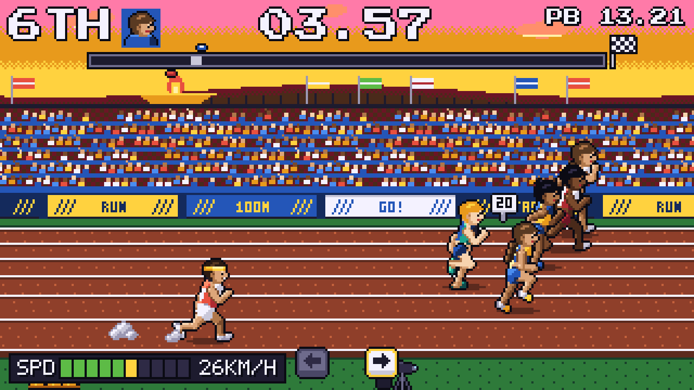
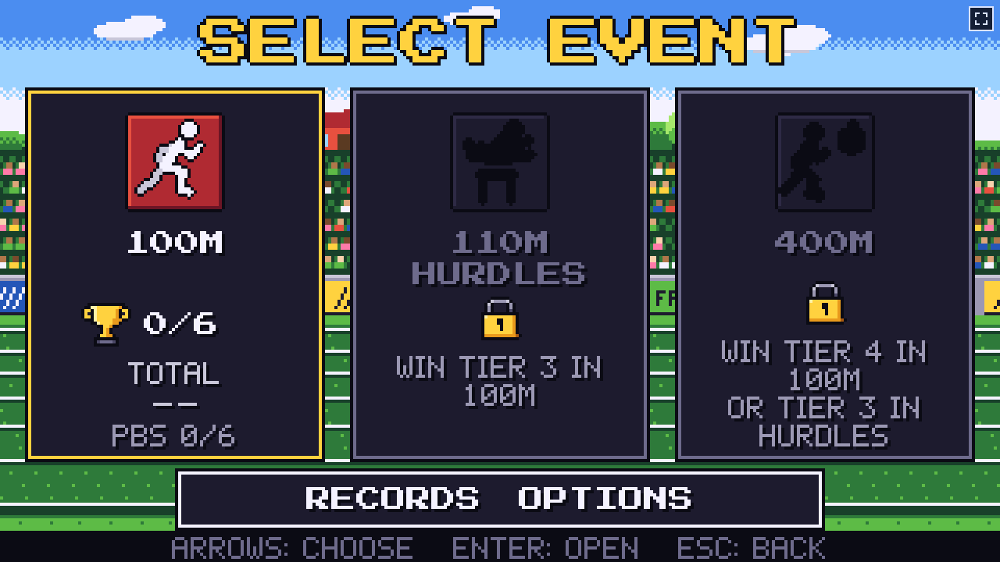
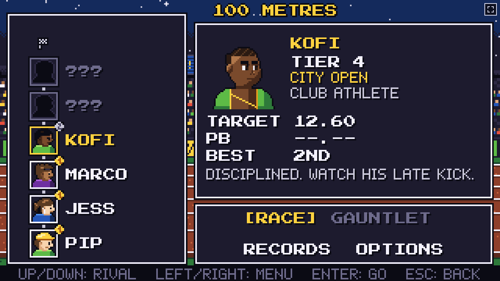
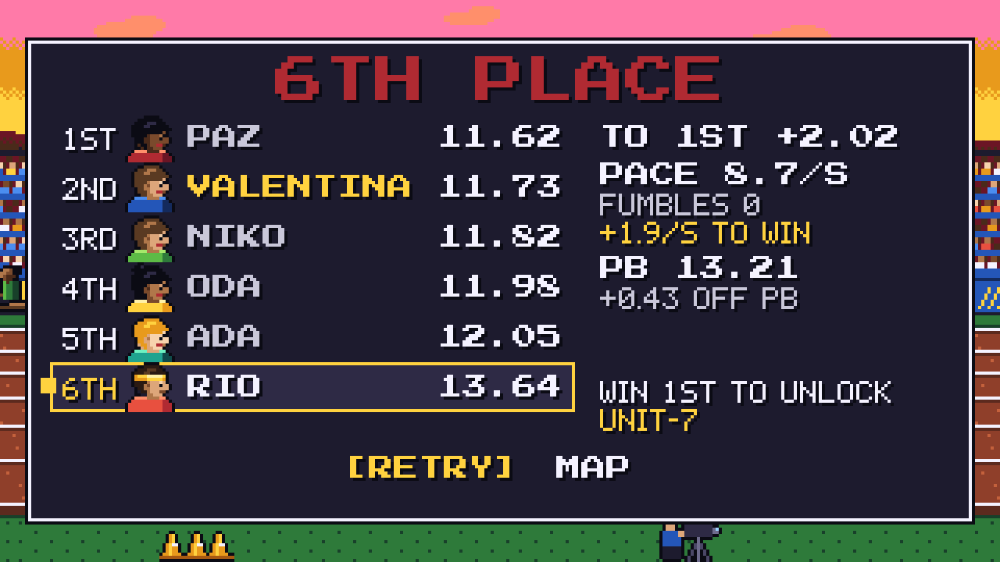

# Retro Runner

A track and field game for the browser, drawn in 16-bit sprite art.
You run by alternating Left and Right as fast as you can, in six-runner races against rivals that range from a primary school student to an alien.

**Play it now: <https://retro-runner-eosin.vercel.app>** (desktop keyboard, or touch on phones and tablets in landscape).



_A 100 m race in progress at the World Games meet. Screenshot of the running game._

## Why play

- **Your hands set the pace.** Speed comes only from alternating presses. Holding a key, key repeat and pressing the same side twice add nothing, so the only way to go faster is to press faster.
- **Three events.** The 100 m is a pure sprint. The 110 m hurdles adds a jump with a timing window. The 400 m adds stamina, so pacing beats flat-out mashing.
- **Six runners per race.** Each meet pits you against a named rival with their own habits plus four runners from the same field, so you pass people, get passed and fight for places.
- **A ladder of meets per event.** Win a meet to unlock the next, from a school sports day upward. Second and third earn medals on the ladder.
- **Gauntlet mode.** Once you have climbed an event's ladder, run every meet back to back. One loss ends the run, and the total time is your score.
- **Every race is timed to the hundredth.** Personal bests, best placings and race history are saved in your browser. Retrying takes one key press.



_Event select on a fresh profile. Winning higher tiers of the 100 m unlocks the hurdles and the 400 m._



_The ladder. Medal pips show your best placing against each rival._



_Every race ends with the full field's places and times, and what to change to win next time._

## Play it locally

It needs Node.js 22.12 or newer and a browser with WebGL.

```bash
npm install
```

```bash
npm run dev
```

Open <http://localhost:5173> and press Enter.
Pick the 100 m, choose RACE against the first rival, and start alternating Left and Right when the countdown ends.

A fresh key press during the countdown is a false start.
A second false start in the same race disqualifies you.

### Controls

| Key                                  | Action                    |
| ------------------------------------ | ------------------------- |
| Left / Right (or A / D), alternating | Run                       |
| Up (or W)                            | Jump (110 m hurdles)      |
| Enter / Space                        | Confirm                   |
| Up / Down (or W / S)                 | Move in menus             |
| Esc                                  | Back / pause              |
| R                                    | Retry on the results card |
| M                                    | Mute                      |
| F                                    | Fullscreen                |

On touch screens the left and right halves of the screen are the run pads, the upper right is the jump pad in the hurdles, and every menu item is tappable.
On iPhone, add the game to your Home Screen to play it full screen.
The game also works offline once it has loaded.

Options include volume, reduced flashing, screen shake, haptics (Android) and an optional CRT filter.
Records are stored in your browser's `localStorage`; if storage is unavailable, the title screen warns that records will not be saved.

## Develop

| Command                      | What it does                                                       |
| ---------------------------- | ------------------------------------------------------------------ |
| `npm run check`              | Lint, format check, unit tests, typecheck and production build     |
| `npm test`                   | Vitest unit tests (headless game logic, art data, audio rendering) |
| `npm run test:e2e`           | Playwright tests on desktop and mobile emulation, with audio muted |
| `npm run build`              | Static build in `dist/`, playable from any static host             |
| `node tools/art/sheet.ts`    | Render sprite contact sheets to `tools/art/out/`                   |
| `node tools/audio/render.ts` | Render every sound and song to WAV in `tools/audio/out/`           |
| `node tools/perf/measure.ts` | Boot, frame-time and memory probe (see `docs/work/performance.md`) |

The game is built with TypeScript, [Phaser](https://phaser.io/) and Vite.
Sprites are palette-indexed pixel maps defined in code, and sound and music are synthesized in the browser, so the repository holds no sprite or audio files.
Every push to `main` deploys to Vercel.

### Layout

| Path                     | Contents                                                                                                               |
| ------------------------ | ---------------------------------------------------------------------------------------------------------------------- |
| `src/core/`              | Pure TypeScript game logic: input rules, mash-to-speed model, hurdles, stamina, race field and AI, records. No Phaser. |
| `src/art/`               | Palette, sprites as palette-indexed pixel maps baked into one atlas at boot, stadium parallax, race view.              |
| `src/audio/`             | Web Audio engine with vendored ZzFX / ZzFXM chiptune synths, rendered in a worker.                                     |
| `src/scenes/`, `src/ui/` | Phaser scenes, HUD, menus, bitmap fonts.                                                                               |
| `src/touch/`             | Touch controls as a DOM overlay driven by Pointer Events.                                                              |
| `e2e/`                   | Playwright end-to-end tests.                                                                                           |
| `docs/design.md`         | Game design document (gameplay numbers, art bible, UI layout).                                                         |
| `docs/research*.md`      | Technology, mobile and game-design research behind the choices.                                                        |

Each layer exposes its public API only through its `index.ts`; ESLint enforces the boundaries.

## Credits

- Press Start 2P font by CodeMan38, SIL Open Font License 1.1 (`public/fonts/`).
- ZzFX by Frank Force and ZzFXM by Keith Clark, MIT (`src/audio/vendor/`).

## License

MIT, see [LICENSE](LICENSE).
